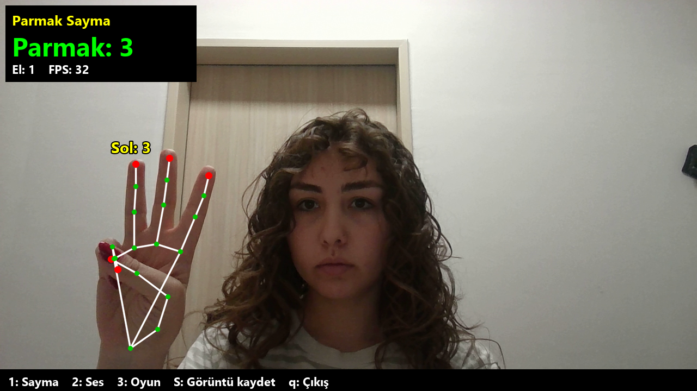
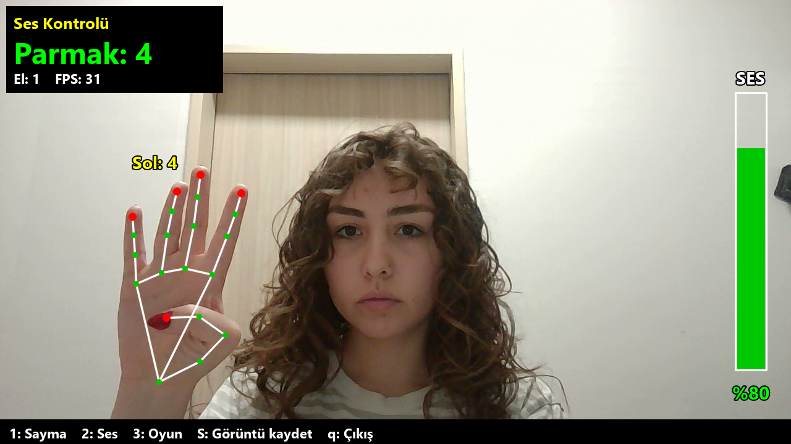
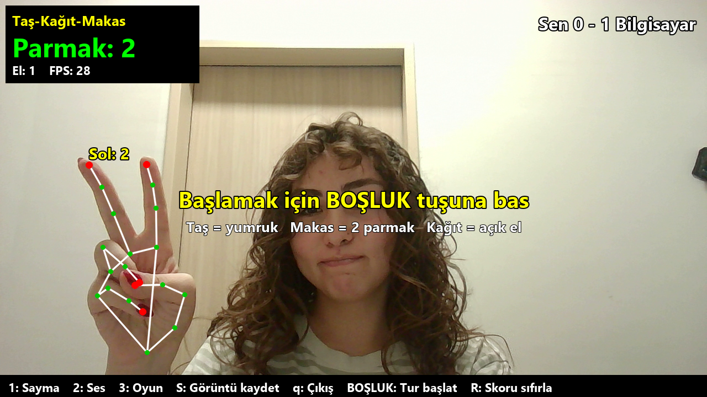

# ✋ Kamerayla El Takibi

Webcam'den canlı görüntü alıp eli tespit eden, elin 21 eklem noktasını ekrana çizen ve **kaç parmağın açık olduğunu** sayan bir Python projesi. Bonus olarak parmak sayısıyla **bilgisayarın ses seviyesi** kontrol edilebiliyor ve bilgisayara karşı **Taş-Kağıt-Makas** oynanabiliyor.

Kullanılan kütüphaneler: **OpenCV** (görüntü alma ve çizim) ve **MediaPipe** (el tespiti).

---

## 📸 Ekran Görüntüleri

### 1. Parmak Sayma
Sol elde 3 açık parmak doğru sayılıyor. 21 eklem noktası ve bağlantıları çiziliyor (parmak uçları kırmızı), elin üstünde "Sol: 3" yazıyor.



### 2. Ses Kontrolü
4 parmak gösterilince ses seviyesi **%80**'e ayarlanıyor. Sağdaki yeşil çubuk güncel ses seviyesini gösteriyor.



### 3. Taş-Kağıt-Makas
2 parmak **Makas** olarak algılanıyor. Skor sağ üstte tutuluyor, oyun BOŞLUK tuşuyla yeni turu bekliyor.



> Görüntüler, program çalışırken her modda **S** tuşuna basılarak `screenshots/` klasörüne kaydedilir (`sayma.png`, `ses.png`, `oyun.png`).

---

## 🎯 Proje Ne Yapıyor?

### Temel özellikler
- **Canlı görüntü:** Webcam'den gerçek zamanlı görüntü alır. Görüntü ayna gibi çevrilir, böylece hareketler doğal görünür.
- **El tespiti:** Aynı anda **2 ele** kadar tespit eder ve her elin **sağ mı sol mu** olduğunu yazar.
- **Eklem noktaları:** Her elin 21 eklem noktasını ve aralarındaki bağlantıları çizer (parmak uçları kırmızı, diğer eklemler yeşil).
- **Parmak sayma:** Her elde kaç parmağın açık olduğunu hesaplar. Toplam sayı (iki elle 0-10) ekranın sol üstünde görünür.
- **Bilgi paneli:** Aktif mod, toplam parmak sayısı, el sayısı ve FPS (saniyedeki kare sayısı).

### Bonus özellikler
- **🔊 Ses kontrolü:** Gösterilen parmak sayısına göre Windows'un ses seviyesi ayarlanır.

  | Parmak | 0 | 1 | 2 | 3 | 4 | 5 |
  |---|---|---|---|---|---|---|
  | Ses | Sessiz | %20 | %40 | %60 | %80 | %100 |

  Yanlışlıkla değişmemesi için parmak sayısı yaklaşık **1 saniye sabit tutulmalıdır**. Bu sürede ekranda dolan sarı bir halka görünür. El kameradan çıkınca ses değişmez.

- **✊✌️🖐️ Taş-Kağıt-Makas:** BOŞLUK tuşuyla 3-2-1 geri sayımı başlar, sayım bitince gösterilen el hareketi bilgisayarın rastgele seçimiyle karşılaştırılır ve skor tutulur.

  | Hareket | Nasıl gösterilir |
  |---|---|
  | Taş | Yumruk (0 parmak) |
  | Makas | 2 parmak |
  | Kağıt | Açık el (4-5 parmak) |

---

## ⚙️ Kurulum

### Gereksinimler
- Windows 10/11
- **Python 3.12** (MediaPipe henüz Python 3.15'i desteklemiyor)
- Bir webcam

### Adımlar

Proje klasöründe PowerShell açıp şunları çalıştırın:

```powershell
# 1) Sanal ortam oluştur (Python 3.12 ile)
py -3.12 -m venv .venv

# 2) Kütüphaneleri kur
.\.venv\Scripts\python.exe -m pip install -r requirements.txt
```

> `mediapipe`, OpenCV'nin tam sürümünü (`opencv-contrib-python`) kendisi kurar. Bu yüzden ayrıca `opencv-python` kurmaya gerek yoktur, `import cv2` normal şekilde çalışır.

El tespit modeli (`models/hand_landmarker.task`, yaklaşık 7,5 MB) **ilk çalıştırmada otomatik olarak indirilir**.

---

## ▶️ Nasıl Çalıştırılır?

```powershell
.\.venv\Scripts\python.exe main.py
```

### Tuşlar

| Tuş | İşlev |
|---|---|
| **1** | Parmak sayma modu |
| **2** | Ses kontrolü modu |
| **3** | Taş-Kağıt-Makas modu |
| **BOŞLUK** | (Oyun modunda) Yeni tur başlat |
| **R** | (Oyun modunda) Skoru sıfırla |
| **S** | Ekran görüntüsü kaydet |
| **q / ESC** | Çıkış |

---

## 🧠 Nasıl Çalışıyor?

1. **Görüntü alma:** OpenCV webcam'den kare alır ve yatayda çevirir.
2. **El tespiti:** MediaPipe'ın **HandLandmarker** modeli her karede elleri bulur ve her el için 21 noktanın koordinatlarını verir.
3. **Parmak sayma:** Noktalar arasındaki **mesafelere** bakılır. Bu sayede el eğik ya da ters tutulduğunda da çalışır:
   - **İşaret, orta, yüzük, serçe:** Parmak ucu bileğe, alt ekleminden daha uzaksa parmak **açıktır**.
   - **Başparmak:** Ucu serçe parmağın kökünden yeterince uzaksa ve işaret parmağının köküne yapışık değilse **açıktır**.
4. **Titremeyi önleme:** Sayı her karede değişip ekranda zıplamasın diye son 5 karede en çok görülen değer kullanılır.
5. **Ses kontrolü:** Ek kütüphane kullanılmaz. Klavyedeki ses aç/kıs tuşlarına basılmış gibi yapılır. Ses önce sıfıra indirilir, sonra istenen seviyeye kadar açılır (her basış %2).

### El eklem noktaları

| Numara | Nokta | Numara | Nokta |
|---|---|---|---|
| 0 | Bilek | 9-12 | Orta parmak (kök → uç) |
| 1-4 | Başparmak (kök → uç) | 13-16 | Yüzük parmağı (kök → uç) |
| 5-8 | İşaret parmağı (kök → uç) | 17-20 | Serçe parmak (kök → uç) |

---

## 📁 Proje Yapısı

```
yztproje2/
├── main.py              # Ana program: kamera, modlar, ekran paneli, tuşlar
├── hand_tracker.py      # El tespiti, eklem çizimi ve parmak sayma
├── volume_control.py    # Parmak sayısıyla ses kontrolü
├── rps_game.py          # Taş-Kağıt-Makas oyunu
├── text_utils.py        # Ekrana Türkçe karakterli yazı (ş, ğ, ı...)
├── requirements.txt     # Gerekli kütüphaneler
├── models/              # El modeli (ilk çalıştırmada iner)
└── screenshots/         # S tuşuyla alınan ekran görüntüleri
```

---

## 📊 Sonuçlar

| Test | Sonuç |
|---|---|
| El tespiti ve eklem çizimi (canlı kamera) | ✅ Çalışıyor |
| Sağ / sol el ayrımı (canlı kamera) | ✅ Doğru (düzeltme sonrası) |
| Boş görüntüde yanlış el algılama | ✅ El bulunmadı (doğru) |
| Açık elde parmak sayısı | ✅ 5 |
| Ses kontrolü (3 parmak → 5 parmak) | ✅ %60 → %100 |
| El kameradan çıkınca ses | ✅ Değişmedi |
| Taş-Kağıt-Makas kuralları (kazanma / kaybetme / berabere) | ✅ Doğru |
| Anlaşılmayan hareket (1 veya 3 parmak) | ✅ "ANLAŞILMADI", skor değişmedi |
| Canlı kamerada tüm modlar | ✅ Kullanıcı tarafından denendi, sorunsuz |
| Canlı kamerada parmak sayısı (3 ve 4 parmak, Makas) | ✅ Doğru (bkz. ekran görüntüleri) |

### Performans (1280×720 kamera, yalnızca işlemci / CPU)

| Mod | FPS |
|---|---|
| Parmak Sayma | ~32 |
| Ses Kontrolü | ~31 |
| Taş-Kağıt-Makas | ~28 |

- Saniyede yaklaşık **30 kare** işlendiği için görüntü akıcıdır. MediaPipe modeli işlemcide çalışır, ekran kartı gerekmez. FPS bilgisayara göre değişir ve ekranın sol üstünde canlı görünür.
- **Türkçe yazı çizimi:** Kare başına yaklaşık 12 ms ekler.

### Bilinen sınırlamalar
- Işık çok azsa ya da el kameraya çok yakın veya uzaksa tespit zorlaşabilir.
- Başparmak, avuç içine doğru yarı bükülü tutulduğunda bazen yanlış sayılabilir.
- Ses ve oyun modunda iki el görünüyorsa **ilk algılanan el** kullanılır.
- Ses kontrolü Windows'a özeldir.

---

## 🛠️ Sorun Giderme

| Sorun | Çözüm |
|---|---|
| `Kamera açılamadı!` | Kamerayı kullanan başka uygulamayı (Zoom, Teams vb.) kapatın. |
| `pip install` takılıyor ya da çok yavaş | İnternet bağlantısını kontrol edin. Python 3.15 değil **3.12** kullandığınızdan emin olun. |
| `module 'mediapipe' has no attribute 'solutions'` | Yeni MediaPipe sürümlerinde eski `solutions` yapısı kaldırıldı. Bu proje yeni **Tasks API** (`HandLandmarker`) kullanır, kodu olduğu gibi kullanın. |
| Terminalde `INFO` / `WARNING` satırları | MediaPipe'ın bilgi mesajlarıdır, hata değildir. |
| Model indirilemiyor | İnternet bağlantısını kontrol edin ya da [modeli](https://storage.googleapis.com/mediapipe-models/hand_landmarker/hand_landmarker/float16/latest/hand_landmarker.task) elle indirip `models/` klasörüne koyun. |
